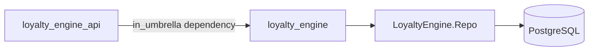
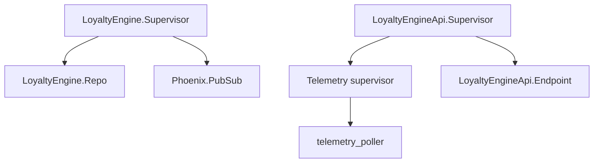
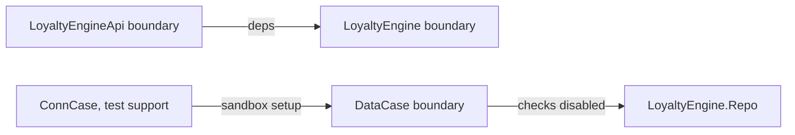
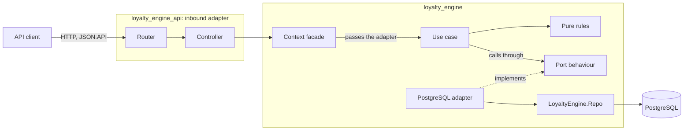
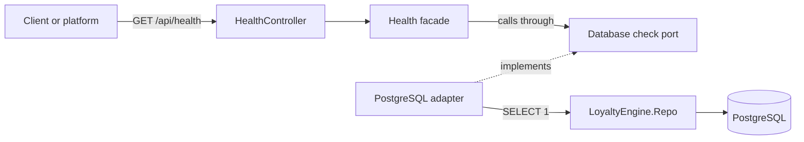
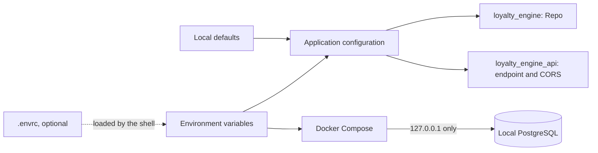

# Architecture

This document describes the structure, responsibilities, and invariants of the
backend. It separates what exists today from what is planned. See
[the design decisions](DECISIONS.md) for the reasoning.

## Current state

The repository contains the Phoenix umbrella, trimmed from the generated
scaffold as described in
[D10](DECISIONS.md#d10-trim-the-scaffold-pin-versions-and-set-the-first-boundaries).
There are no business contexts, Ecto schemas, migrations, or API routes, and the
health endpoint is not implemented.

### Applications

| Application | Contents today |
| --- | --- |
| `loyalty_engine` | `Repo` for PostgreSQL and an empty root module |
| `loyalty_engine_api` | Endpoint, empty `/api` router scope, telemetry |

`loyalty_engine_api` depends on `loyalty_engine`. The domain application does
not depend on Phoenix or on the API application. It does declare
`phoenix_pubsub`, a library that is independent from the Phoenix web framework.



### Supervision

Each application has its own supervisor with a `:one_for_one` strategy. OTP
starts `loyalty_engine` before the application that depends on it.



The endpoint is configured to use the PubSub server started by the domain
application. No application code publishes or subscribes to events.

### Boundaries

`Boundary` runs as a compiler in both applications.



Neither application boundary exports modules, so the API cannot use internal
modules such as `Repo`. Violations are compiler warnings, which fail the build
only with `--warnings-as-errors`. A dependency from the domain to the API also
fails that build, because Elixir cannot find the module. `DataCase` is a
top-level boundary without checks, compiled only for tests.

### HTTP behavior

The endpoint parses only JSON request bodies. It has no sessions and serves no
static files. Debug error pages are disabled in development, so errors use the
same renderer as in the other environments.

The router defines an `/api` scope with a pipeline that accepts `json`, and no
routes. Errors are rendered by the generated `LoyaltyEngineApi.ErrorJSON`, with
the shape `{"errors": {"detail": "..."}}`. This is not the JSON:API format
agreed in [D4](DECISIONS.md#d4-follow-jsonapi-and-postpone-openapi).

### Configuration

`.tool-versions` pins Erlang/OTP 29.1.2 and Elixir 1.20.5, and both
applications require Elixir `~> 1.20`. Development and test hardcode the
database connection and do not read the `PG*` variables. `PORT` is read in every
environment. Production requires `DATABASE_URL` and `SECRET_KEY_BASE`. Docker
Compose publishes PostgreSQL on every interface. CORS is not configured.

## Planned design

Nothing in this section is implemented yet.

### Responsibilities

- `loyalty_engine` owns the domain: contexts, use cases, rules, ports, and the
  persistence adapters, together with `Repo` and the migrations.
- `loyalty_engine_api` is the inbound HTTP adapter. It owns routing,
  controllers, the JSON:API representation, CORS, and HTTP integration tests.
  It calls only the public context facades.

### Hexagonal structure

The design follows [D7](DECISIONS.md#d7-use-a-hexagonal-architecture-with-enforced-boundaries).

| Element | Role |
| --- | --- |
| Facade | Inbound port of a context; injects adapters into use cases |
| Use case | Orchestrates one business action through ports |
| Rules | Pure business logic, without effects |
| Port | Behaviour that states what the context needs and its guarantees |
| Adapter | Implements a port with a concrete technology |

Directories are named after business capabilities. The following layout is an
example: context names and limits are decided in step 5.1.

```text
apps/loyalty_engine/lib/loyalty_engine/
  repo.ex
  wallets.ex                  # public facade
  wallets/
    redeem_points.ex          # use case
    movement.ex               # pure rules
    ports/ledger.ex           # outbound port
    adapters/postgres/        # port implementation, schemas, and queries
```

### Request flow

Solid arrows are calls at runtime. Dotted arrows show which module implements a
port.



A controller validates the shape of the request, calls a facade, and renders the
result. The domain returns its own results, without HTTP statuses or JSON:API
structures.

### Health check

`GET /api/health` reports readiness, with the contract defined in
[D8](DECISIONS.md#d8-expose-a-single-readiness-health-endpoint). `Health` is an
operational capability rather than a business context.



| Facade result | HTTP response |
| --- | --- |
| `:ok` | `200` with a `meta` document |
| `{:error, :unavailable}` | `503` with an `errors` document |

The facade has no use case and calls the injected port directly. The target time
limit of the check is two seconds, including the wait for a connection.

### Environment and CORS

[D9](DECISIONS.md#d9-configure-through-environment-variables-and-restrict-cors)
defines the variables, their defaults, and the CORS rules.



- Local defaults apply when a variable is unset. Production secrets and the
  database URL have no defaults.
- Invalid ports or CORS origins stop the application at startup, with an error
  that names the variable and shows no secrets.
- CORS belongs to the HTTP adapter and needs no domain port. No origin is
  allowed unless it is configured.

### Dependency injection

Configuration selects the adapter for each port. The facade reads it and passes
the adapter to the use case as an explicit argument, so a use case never looks
it up. A test of a use case passes a fake instead. The health check has no use
case, so its facade calls the selected adapter through the port. Configuration
keys are not decided.

### Allowed dependencies

The two application boundaries exist. Boundaries inside the domain are declared
when their modules appear, and each context facade is then exported to the API.
The rules between elements of a context are the target of that work.

| From | May use | Must not use |
| --- | --- | --- |
| HTTP adapter | Context facades | Use cases, ports, adapters, `Repo` |
| Use cases and rules | Domain types, ports | Adapters, Ecto, `Repo`, HTTP |
| Persistence adapter | Its port, domain types, Ecto, `Repo` | HTTP |

A facade is the only part of a context that other code calls. It may refer to
adapters only to wire them, which configuration does by naming the module. The
health check follows the same rules: its controller does not use `Repo`.

### Testing

- Rules are tested directly, and use cases with fake adapters.
- Persistence adapters are tested against PostgreSQL. Only these tests can
  verify atomicity, locking, constraints, and idempotency.
- API integration tests cover the HTTP contract and the complete flow.
- A fake adapter reproduces the unavailable database for the health check.

### Invariants

In addition to the one-way dependency between the applications, which already
holds, the design requires that:

- Contexts do not depend on each other's persistence internals.
- PostgreSQL is the source of truth for durable state.
- One owner controls each transaction. For an operation of a persistence port,
  the owner is its adapter.

The business rules are listed in section 4 of [the brief](CHALLENGE.md). The
data model, balance strategy, concurrency, idempotency, and transactions across
contexts are not decided. OTP processes and real-time events are added only
when a roadmap step needs them.
