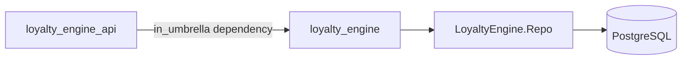
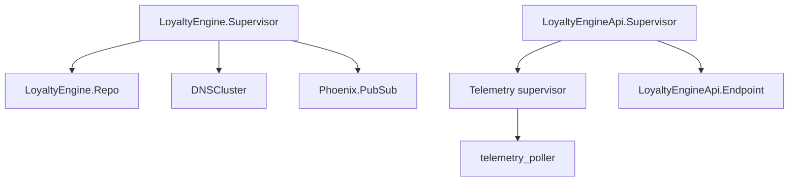
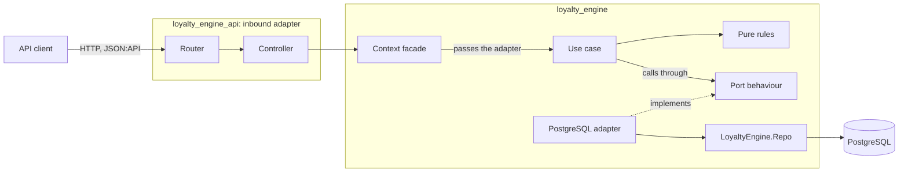

# Architecture

This document describes the structure, responsibilities, and invariants of the
backend. It separates what exists today from what is planned. See
[the design decisions](DECISIONS.md) for the reasoning.

## Current state

The repository contains the generated Phoenix umbrella. There are no business
contexts, Ecto schemas, migrations, or API routes, and the health endpoint is
not implemented.

### Applications

| Application | Contents today |
| --- | --- |
| `loyalty_engine` | `Repo` for PostgreSQL and an empty root module |
| `loyalty_engine_api` | Endpoint, empty `/api` router scope, telemetry |

`loyalty_engine_api` depends on `loyalty_engine`. The domain application does
not depend on Phoenix or on the API application. It does declare
`phoenix_pubsub`, a library that is independent from the Phoenix web framework.



### Supervision

Each application has its own supervisor with a `:one_for_one` strategy. OTP
starts `loyalty_engine` before the application that depends on it.



The endpoint is configured to use the PubSub server started by the domain
application. No application code publishes or subscribes to events.

### HTTP behavior

The router defines an `/api` scope with a pipeline that accepts `json`, and no
routes. Errors are rendered by the generated `LoyaltyEngineApi.ErrorJSON`, with
the shape `{"errors": {"detail": "..."}}`. This is not the JSON:API format
agreed in [D4](DECISIONS.md#d4-follow-jsonapi-and-postpone-openapi).

## Planned design

Nothing in this section is implemented yet.

### Responsibilities

- `loyalty_engine` owns the domain: contexts, use cases, rules, ports, and the
  persistence adapters, together with `Repo` and the migrations.
- `loyalty_engine_api` is the inbound HTTP adapter. It owns routing,
  controllers, the JSON:API representation, CORS, and HTTP integration tests.
  It calls only the public context facades.

### Hexagonal structure

The design follows [D7](DECISIONS.md#d7-use-a-hexagonal-architecture-with-enforced-boundaries).

| Element | Role |
| --- | --- |
| Facade | Inbound port of a context; injects adapters into use cases |
| Use case | Orchestrates one business action through ports |
| Rules | Pure business logic, without effects |
| Port | Behaviour that states what the context needs and its guarantees |
| Adapter | Implements a port with a concrete technology |

Directories are named after business capabilities. The following layout is an
example: context names and limits are decided in step 5.1.

```text
apps/loyalty_engine/lib/loyalty_engine/
  repo.ex
  wallets.ex                  # public facade
  wallets/
    redeem_points.ex          # use case
    movement.ex               # pure rules
    ports/ledger.ex           # outbound port
    adapters/postgres/        # port implementation, schemas, and queries
```

### Request flow

Solid arrows are calls at runtime. Dotted arrows show which module implements a
port.



A controller validates the shape of the request, calls a facade, and renders the
result. The domain returns its own results, without HTTP statuses or JSON:API
structures.

### Dependency injection

Configuration selects the adapter for each port. The facade reads it and passes
the adapter to the use case as an explicit argument, so a use case never looks
it up. A test of a use case passes a fake instead. Configuration keys are not
decided.

### Allowed dependencies

Step 2.1 introduces `Boundary`, and each boundary is declared when its modules
appear.

| From | May use | Must not use |
| --- | --- | --- |
| HTTP adapter | Context facades | Use cases, ports, adapters, `Repo` |
| Use cases and rules | Domain types, ports | Adapters, Ecto, `Repo`, HTTP |
| Persistence adapter | Its port, domain types, Ecto, `Repo` | HTTP |

A facade is the only part of a context that other code calls. It may refer to
adapters only to wire them, which configuration does by naming the module. A
health check that needs the database is not covered yet; step 1.2 decides it.

### Testing

- Rules are tested directly, and use cases with fake adapters.
- Persistence adapters are tested against PostgreSQL. Only these tests can
  verify atomicity, locking, constraints, and idempotency.
- API integration tests cover the HTTP contract and the complete flow.

### Invariants

In addition to the one-way dependency between the applications, which already
holds, the design requires that:

- Contexts do not depend on each other's persistence internals.
- PostgreSQL is the source of truth for durable state.
- One owner controls each transaction. For an operation of a persistence port,
  the owner is its adapter.

The business rules are listed in section 4 of [the brief](CHALLENGE.md). The
data model, balance strategy, concurrency, idempotency, and transactions across
contexts are not decided. OTP processes and real-time events are added only
when a roadmap step needs them.
